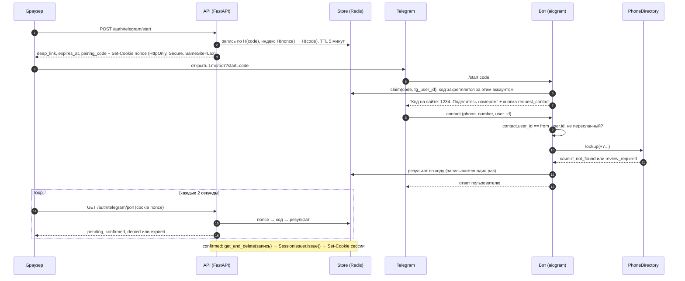

# tg-site-login

Вход на сайт через Telegram-бота с подтверждением телефона и уведомления о заказах и заявках в чат менеджеров.
Python 3.12, aiogram 3, FastAPI, Redis.

- **Вход без паролей и SMS.** Сайт выдаёт одноразовую ссылку `https://t.me/<бот>?start=<код>`, бот просит поделиться контактом кнопкой, сверяет телефон со списком клиентов, а браузер, который начал вход, получает сессию.
- **Уведомления менеджерам.** Новые заказы, заявки и напоминание «заказ не оплачен 30 минут» уходят в Telegram-чат: HTML с экранированием, разбиение по лимиту 4096 символов, повторы с экспоненциальной паузой и джиттером, защита от дублей, выключатель.
- **Подключаемые части.** Справочник клиентов (`PhoneDirectory`), выдача сессии (`SessionIssuer`) и хранилище (`Store`: память или Redis) задаются интерфейсами. Свою базу и свою систему сессий подставляете без правки библиотеки.

Это не готовый магазин и не фреймворк авторизации, а проверенная заготовка для одной связки: «телефон клиента подтверждён через Telegram, дальше выдаём сессию».

## Содержание

1. [Как это работает](#как-это-работает)
2. [Быстрый старт](#быстрый-старт)
3. [HTTP API](#http-api)
4. [Подключение к своему проекту](#подключение-к-своему-проекту)
5. [Уведомления](#уведомления)
6. [Модель безопасности](#модель-безопасности)
7. [Конфигурация](#конфигурация)
8. [Уроки из продакшена](#уроки-из-продакшена)
9. [Ограничения](#ограничения)
10. [Разработка и тесты](#разработка-и-тесты)
11. [Структура проекта](#структура-проекта)

## Как это работает



Два процесса, общий Redis:

| Процесс | Что делает | Команда |
| --- | --- | --- |
| `api` | `POST /auth/telegram/start`, `GET /auth/telegram/poll`, `POST /internal/notify` | `uvicorn tg_site_login.wiring:create_app_from_env --factory` |
| `bot` | long polling (по умолчанию) или webhook | `python -m tg_site_login.bot` |

Бот работает через long polling: ему не нужны ни публичный адрес, ни входящие соединения. Webhook включается переменной `BOT_MODE=webhook` и проверяет заголовок `X-Telegram-Bot-Api-Secret-Token`.

## Быстрый старт

Нужны Docker с Compose и бот от [@BotFather](https://t.me/BotFather).

1. Создайте бота в BotFather, возьмите токен и имя пользователя бота.
2. Подготовьте окружение:

   ```bash
   cp .env.example .env
   ```

   В `.env` задайте `BOT_TOKEN` и `BOT_USERNAME`. Для проверки на `http://localhost` поставьте `COOKIE_SECURE=false`: браузеры и curl не отправляют `Secure`-cookie по http.
3. Добавьте в `examples/customers.example.json` запись со своим номером телефона в формате `+7...`. Это демо-справочник, в боевой системе его заменяет ваш `PhoneDirectory`.
4. Запустите:

   ```bash
   docker compose up --build
   ```

5. Пройдите вход вручную:

   ```bash
   # 1. получить ссылку и cookie
   curl -s -c jar.txt -X POST http://localhost:8000/auth/telegram/start
   # 2. открыть deep_link из ответа в Telegram, нажать Start, поделиться номером
   # 3. спросить результат
   curl -s -b jar.txt -c jar.txt http://localhost:8000/auth/telegram/poll
   ```

   Пока вы не подтвердили контакт, ответ `{"status":"pending"}`. После подтверждения следующий запрос возвращает `{"status":"confirmed"}` и ставит cookie сессии, повторный вернёт `{"status":"expired"}`: код одноразовый.

Готовая страница для сайта лежит в [`examples/login-widget.html`](examples/login-widget.html). Отдавайте её с того же origin, что и API.

Без Docker: `python3.12 -m venv .venv && .venv/bin/pip install -e ".[dev]"`, поднимите Redis 7 и запустите два процесса командами из таблицы выше. Для опытов в одном процессе есть `STORE_BACKEND=memory`, но API и бот при этом не смогут обменяться состоянием, поэтому на практике он нужен только тестам.

## HTTP API

| Запрос | Ответ |
| --- | --- |
| `POST /auth/telegram/start` | `200 {"deep_link", "expires_at", "pairing_code"}` и `Set-Cookie` с nonce. `403 origin_not_allowed`, `429` с `Retry-After`, `503 login_disabled` |
| `GET /auth/telegram/poll` | `200 {"status": "pending" \| "confirmed" \| "denied" \| "expired"}`; при `denied` есть `"reason": "not_found" \| "review_required"`. При `confirmed` ставится cookie сессии |
| `POST /internal/notify` | Включается, когда заданы `NOTIFY_CHAT_ID` и `NOTIFY_API_TOKEN`. Заголовок `Authorization: Bearer <токен>`. Тело: `{"kind": "order_created" \| "lead_created" \| "order_unpaid", ...}`. Ответ `{"result": "sent" \| "duplicate" \| "disabled" \| "in_progress"}`, `502` при неудачной доставке |
| `GET /healthz` | `{"status": "ok"}` |

`pairing_code` добавлен сверх минимального контракта, это четырёхзначный код, который сайт показывает пользователю, а бот повторяет в сообщении. Зачем он нужен, описано в разделе про фишинг.

Все ответы `/auth/*` идут с `Cache-Control: no-store`. Любой браузер без подходящего nonce получает `expired`, то есть ответ, неотличимый от «такого входа нет».

## Подключение к своему проекту

### Справочник клиентов

```python
from tg_site_login.directory import Customer, DenyReason, LookupResult


class ShopDirectory:
    async def lookup(self, phone_e164: str) -> LookupResult:
        rows = await db.fetch_customers_by_phone(phone_e164)
        if not rows:
            return LookupResult.denied(DenyReason.NOT_FOUND)
        if len(rows) > 1:  # неоднозначно: лучше отказать, чем войти под чужим профилем
            return LookupResult.denied(DenyReason.REVIEW_REQUIRED)
        return LookupResult.found(Customer(str(rows[0].id), rows[0].name))
```

Готовый вариант для SQL лежит в `tg_site_login.sql_directory.SqlPhoneDirectory`. Он не зависит от драйвера: вы даёте объект с методом `fetch_all(query, params)`, а правила (нет строк, больше одной строки, нет источников, есть причины для проверки) описаны в docstring модуля. Подключение по строке импорта:

```
DIRECTORY_FACTORY=my_shop.auth:make_directory      # функция (settings) -> PhoneDirectory
SESSION_ISSUER_FACTORY=my_shop.auth:make_issuer    # функция (settings, store) -> SessionIssuer
```

### Выдача сессии

```python
from tg_site_login.directory import Customer
from tg_site_login.sessions import IssuedSession


class ShopSessionIssuer:
    async def issue(self, customer: Customer) -> IssuedSession:
        token = await my_sessions.create(user_id=customer.customer_id)
        return IssuedSession(cookie_name="sid", value=token, max_age=86400)
```

`issue()` вызывается не больше одного раза на вход и только после того, как код сожжён. Справочный `StoreSessionIssuer` хранит случайный токен как хэш в `Store`.

### Как библиотека

```python
from tg_site_login.login import LoginService
from tg_site_login.redis_store import RedisStore

store = RedisStore.from_url("redis://localhost:6379/0")
login = LoginService(store, ShopDirectory(), ShopSessionIssuer(), ttl=300)

# API: login.start(previous_nonce=...), login.poll(nonce)
# Бот: login.claim(code, tg_user_id), login.submit_contact(tg_user_id, contact.user_id, contact.phone_number)
```

Роутер бота: `tg_site_login.bot.handlers.build_router(login, site_name="shop.example")`. Тексты бота меняются через `Texts`.

## Уведомления

```python
from decimal import Decimal

from tg_site_login.events import OrderCreated, OrderItem
from tg_site_login.notifier import Notifier

notifier = Notifier(bot, chat_id, store, is_enabled=lambda: settings.notify_enabled)
await notifier.notify(
    OrderCreated(
        order_id="1001",
        customer_name="Anna",
        items=(OrderItem("T-shirt", 2, Decimal("990")),),
        phone="+79990000001",
    )
)
```

События: `OrderCreated`, `LeadCreated`, `OrderUnpaid`, `PlainTextEvent`. Свои события реализуют два члена протокола `NotificationEvent`: `dedupe_key` и `render()`.

Что гарантирует `Notifier`:

- **HTML безопасен.** Любое пользовательское значение сначала обрезается, потом экранируется. Комментарий покупателя с `<b>` не ломает сообщение и не вставляет разметку.
- **Лимит 4096.** Лимит Bot API считается по тексту после разбора разметки. Длинное сообщение режется по переносам строк, а если строка слишком длинная, то между символами, но не внутри тега или сущности. Открытые теги закрываются в конце куска и открываются в начале следующего. Длина считается консервативно, в UTF-16 code units.
- **Повторы.** Сетевые ошибки, таймауты и 5xx повторяются с паузой `base * 2^n`, ограниченной сверху и размазанной джиттером. На `429` ждём `retry_after` из ответа Telegram, а если он больше `max_retry_after`, отказываемся сразу. Каждая попытка ограничена таймаутом. Ошибки навроде `Forbidden` и `BadRequest` не повторяются.
- **Дедупликация.** Ключ события хранится в `Store`. Повторный `notify()` с тем же ключом ничего не отправляет. Сообщение из нескольких частей запоминает, сколько частей доставлено, и после сбоя продолжает с недостающей. Замок не даёт двум воркерам отправлять одно событие одновременно.
- **Выключатель.** `NOTIFY_ENABLED=false`. Проверяется на каждом вызове, выключенные события не помечаются как доставленные.
- **Темп.** Не чаще одного сообщения в секунду на процесс, так что чат не упирается во flood control.

Напоминание «заказ не оплачен» делает `UnpaidOrderReminder`. Он берёт у вашего `OrderSource` заказы, которые ждут оплаты от 30 минут до суток, перепроверяет статус прямо перед отправкой и шлёт одно напоминание на заказ.

## Модель безопасности

| Угроза | Что делает проект | Остаточный риск |
| --- | --- | --- |
| **Фишинг кода.** Злоумышленник начинает вход в своём браузере и присылает жертве свою deep-ссылку. Если жертва поделится номером, сессия достанется браузеру злоумышленника | Бот пишет, на каком сайте происходит вход, и повторяет `pairing_code`, который виден на экране сайта. Если на сайте код другой или человек вход не начинал, подтверждать нельзя. Код живёт 5 минут и закрепляется за первым Telegram-аккаунтом, открывшим ссылку | Это социальная инженерия, и техника её полностью не закрывает. Человек может проигнорировать предупреждение. Для чувствительных действий нужен второй фактор |
| **Login CSRF.** Чужой сайт заставляет браузер жертвы начать вход или войти в чужой профиль | `POST /start` проверяет `Origin` (свой сайт или список `ALLOWED_ORIGINS`) и заголовок `Sec-Fetch-Site`. Cookie имеет `SameSite=Lax`. Результат привязан к nonce, который знает только браузер | Защита рассчитана на современные браузеры, которые присылают `Origin` |
| **Кража nonce.** Скрипт на странице или соседний поддомен читает или подменяет cookie | Cookie `HttpOnly`, `Secure`, без `Domain`, с префиксом `__Host-`: поддомен не может её подменить. Nonce длиной 256 бит, в хранилище лежит только его SHA-256 | XSS на самом сайте всё равно позволяет действовать от имени пользователя, но nonce не прочитать |
| **Пересланный или чужой контакт.** Пользователь шлёт контакт другого человека | Принимается контакт, только если `contact.user_id == message.from_user.id`. Пересланные сообщения и контакты без `user_id` отклоняются. Контакт проверяется в `LoginService`, а не только в обработчике | Опора на то, что Telegram сам заполняет `user_id`. Номер, перешедший к другому человеку, и перехват SIM Telegram не отличит |
| **Повторное использование (replay).** Перехваченную ссылку или ответ используют заново | Код одноразовый: запись сжигается атомарным `get_and_delete`, при гонке двух запросов сессию получает один. Результат пишется один раз (`SET NX`), его нельзя перезаписать. TTL 5 минут, срок проверяется и в самом сервисе | Если `SessionIssuer` упал после сжигания кода, пользователю придётся начать вход заново: так выбрано намеренно, чтобы не выдать две сессии |
| **Перебор.** Подбор кода, nonce или спам ссылками | Код 192 бита, nonce 256 бит. Лимит на `start` по IP и на `poll` по IP. Неверные коды считаются по Telegram-аккаунту (`BAD_CODE_LIMIT`), после лимита бот отвечает «слишком много неверных ссылок». Все неудачные опросы возвращают одинаковый `expired` | Окно лимитера фиксированное, на границе окон возможен всплеск. За общим NAT лимит делится между людьми |
| **Утечка Redis.** Кто-то читает дамп | Коды и nonce хранятся как SHA-256, телефон не хранится вовсе, сессионные токены хранятся хэшем | Хэш не спасёт, пока код жив: он короткоживущий, но в этот момент запись видна |
| **Подделка webhook.** Кто-то шлёт апдейты на адрес бота | Заголовок `X-Telegram-Bot-Api-Secret-Token` сравнивается через `hmac.compare_digest` до разбора тела | Секрет единственный, фильтра по IP Telegram нет |
| **Подмена IP для обхода лимитов.** Клиент присылает `X-Forwarded-For` | Заголовок с адресом клиента читается только если задан `CLIENT_IP_HEADER`, а прокси обязан его перезаписывать. Иначе берётся адрес сокета | Неправильно настроенный прокси сводит защиту на нет |
| **Аварийная остановка.** Нужно срочно выключить вход | `LOGIN_ENABLED=false` останавливает `start`, `poll` и бота, включая выдачу сессий | Нужен перезапуск `api` и `bot` |

Проект не пишет в журнал коды, nonce и полные телефоны (телефон маскируется), а логгеры HTTP-клиентов переведены на WARNING, чтобы URL с токеном бота не попадал в лог.

## Конфигурация

Настройки читаются из переменных окружения и файла `.env` ([`.env.example`](.env.example)). Пустое значение (`NAME=`) считается «не задано».

| Переменная | По умолчанию | Назначение |
| --- | --- | --- |
| `BOT_TOKEN` | обязательна | Токен бота |
| `BOT_USERNAME` | обязательна | Имя бота без `@`, для deep-ссылки |
| `SITE_NAME` | `shop.example` | Название сайта в сообщениях бота |
| `TELEGRAM_CONNECT_TIMEOUT` | `5` | Таймаут установки TCP-соединения с Bot API, секунды |
| `TELEGRAM_REQUEST_TIMEOUT` | `15` | Таймаут запроса к Bot API, секунды |
| `STORE_BACKEND` | `redis` | `redis` или `memory` |
| `REDIS_URL` | `redis://localhost:6379/0` | Адрес Redis 7 или новее |
| `LOGIN_ENABLED` | `true` | Выключатель входа |
| `LOGIN_CODE_TTL_SECONDS` | `300` | Время жизни кода, 30..3600 |
| `ALLOWED_ORIGINS` | пусто | Origin-ы, которым разрешён `POST /start`, через запятую. Собственный origin сайта разрешён всегда |
| `CLIENT_IP_HEADER` | не задан | Заголовок с адресом клиента (например `X-Real-IP`), только если прокси его перезаписывает |
| `START_RATE_LIMIT`, `START_RATE_WINDOW_SECONDS` | `10`, `60` | Лимит `start` на IP |
| `POLL_RATE_LIMIT`, `POLL_RATE_WINDOW_SECONDS` | `120`, `60` | Лимит `poll` на IP |
| `BAD_CODE_LIMIT`, `BAD_CODE_WINDOW_SECONDS` | `5`, `600` | Неверные коды на Telegram-аккаунт |
| `COOKIE_SECURE` | `true` | `false` только для разработки по http; имя cookie тогда без `__Host-` |
| `SESSION_COOKIE_NAME`, `SESSION_TTL_SECONDS` | `session`, `2592000` | Параметры справочного `StoreSessionIssuer` |
| `DIRECTORY_FILE` | не задан | JSON для встроенного справочника в памяти |
| `DIRECTORY_FACTORY` | не задан | `package.module:function`, получает `Settings`, возвращает `PhoneDirectory` |
| `SESSION_ISSUER_FACTORY` | не задан | `package.module:function`, получает `(Settings, Store)`, возвращает `SessionIssuer` |
| `NOTIFY_ENABLED` | `true` | Выключатель уведомлений менеджерам |
| `NOTIFY_CHAT_ID` | не задан | Чат менеджеров |
| `NOTIFY_API_TOKEN` | не задан | Токен (16+ символов) для `POST /internal/notify`; без него эндпоинта нет |
| `NOTIFY_MAX_ATTEMPTS` | `5` | Число попыток отправки |
| `NOTIFY_MIN_INTERVAL_SECONDS` | `1` | Пауза между сообщениями |
| `BOT_MODE` | `polling` | `polling` или `webhook` |
| `POLLING_TIMEOUT_SECONDS` | `20` | Длина long polling запроса |
| `WEBHOOK_URL`, `WEBHOOK_SECRET` | не заданы | Для webhook: https-адрес и секрет из `A-Za-z0-9_-`, 1..256 символов |
| `WEBHOOK_HOST`, `WEBHOOK_PORT` | `0.0.0.0`, `8081` | Где слушает webhook-сервер |
| `LOG_LEVEL` | `INFO` | Уровень логов |

## Уроки из продакшена

Всё это было выучено на живой системе. Здесь без привязки к конкретному проекту.

- **Webhook подходит не везде.** На части VPS Telegram не может достучаться до сервера. Long polling не требует входящих соединений, поэтому он выбран по умолчанию, а webhook остаётся опцией.
- **Часть TCP-рукопожатий к `api.telegram.org` зависает.** На одном хостинге порядка четверти соединений. Без таймаута вызов стоит минуты, без повторов ответ бота пропадает. Поэтому у сессии отдельный короткий таймаут подключения (`ResilientAiohttpSession`), а каждый вызов Bot API идёт через `call_with_retry`.
- **Повторять надо и ответы бота, не только рассылку.** Состояние входа уже записано в хранилище, потерянный ответ не должен ломать вход.
- **`retry_after` надо уважать.** Flood control отвечает `429` со временем ожидания. Если долбить дальше, чат блокируется на дольше.
- **Телефон и есть личность.** Ключом клиента надёжнее брать телефон, а не идентификатор карты лояльности: разные системы нумеруют карты независимо, и один код может принадлежать разным людям. Дубли и спорные записи лучше отдавать на ручную проверку (`review_required`), чем угадывать.
- **Telegram подтверждает телефон, почта и имя нет.** Если вы сопоставляете клиентов ещё и по почте или по имени, правила должны быть строже, чем для Telegram.
- **Лимиты по IP и общий NAT.** За операторским NAT много людей делят один адрес, слишком жёсткий лимит бьёт по настоящим клиентам. Зато заголовок с адресом клиента нельзя брать на веру: если приложение читает `X-Forwarded-For`, который прокси не перезаписывает, лимиты обходятся.
- **Выключатель на каждый внешний канал.** Отдельные флаги для входа и для уведомлений позволяют отключить поломанную часть без релиза.
- **Не логируйте URL запросов к Bot API.** Токен бота стоит в пути запроса, а HTTP-клиент на уровне INFO его печатает. Токен, попавший в лог или чат, перевыпускайте.
- **Напоминания: «не больше одного раза», а не «хотя бы раз».** Метку нужно ставить до отправки, окно напоминаний ограничивать (от 30 минут до суток), а статус заказа перечитывать перед отправкой. Иначе после простоя менеджеров завалит старыми заказами, а оплаченные заказы получат напоминание.
- **Темп отправки.** Не чаще одного сообщения в секунду в чат, и очередь, где заказы идут впереди заявок.
- **При перезапуске бота апдейты могут прийти повторно.** Обработчики идемпотентны: повторный контакт отвечает «этот вход уже обработан».

## Ограничения

- **Тесты не ходят в сеть.** Bot API подменён фальшивой сессией, Redis заменён `fakeredis`. Против настоящего Telegram, настоящего Redis и собранного Docker-образа проект в этом репозитории не прогонялся.
- **Фишинг закрыт частично.** `pairing_code` помогает внимательному человеку, но не заменяет второй фактор. Если жертва подтвердит чужую ссылку, браузер злоумышленника получит сессию.
- **Телефон не равен человеку.** Бот доказывает лишь то, что Telegram считает контакт принадлежащим этому аккаунту. Перевыпущенный номер и перехват SIM остаются вне модели.
- **Уведомления доставляются «хотя бы раз» при неоднозначных сбоях.** Если запрос ушёл, а ответ потерялся по таймауту, повтор может дать дубль. Дубль менеджеру предпочтительнее потери. Дедупликация защищает от повторных вызовов, но не от таких сбоев.
- **Redis.** Нужен Redis 7+ (`PEXPIRE ... NX`). Кластер не проверялся. Если Redis теряет данные, пропадают ключи дедупликации и повторные уведомления возможны, а незавершённые входы придётся начать заново. Compose включает AOF.
- **Лимитер с фиксированным окном.** На границе окон возможен двойной всплеск.
- **Один long polling процесс на токен.** Две копии бота дадут ошибку `Conflict`. Для нескольких реплик используйте webhook.
- **Webhook защищён только секретом.** Фильтра по IP-адресам Telegram нет, закройте порт файрволом и пропускайте только прокси.
- **Нормализация телефонов ориентирована на РФ.** Это не libphonenumber. Голые 11 цифр с `8` читаются как российские, иностранный номер вида `84...` без `+` будет понят неверно.
- **Тексты бота на русском.** Замена через `Texts`, но готовой локализации нет.
- **`/internal/notify` защищён общим токеном.** Для публичного доступа добавьте mTLS или закрытую сеть.
- **Нет выхода из сессии и управления сессиями.** Это зона вашего `SessionIssuer`.
- **Нижние границы зависимостей проверены** прогоном тестов на минимальных версиях (aiogram 3.13, FastAPI 0.115, redis-py 5.0.1, pydantic 2.8, pydantic-settings 2.7). Верхние версии проверены на актуальных на момент написания.

## Разработка и тесты

```bash
python3.12 -m venv .venv
.venv/bin/pip install -e ".[dev]"

.venv/bin/ruff check .
.venv/bin/ruff format --check .
.venv/bin/mypy          # strict
.venv/bin/pytest
```

Все телефоны, имена, идентификаторы чатов и токены в примерах и тестах вымышлены. В российской нумерации нет зарезервированного диапазона для вымышленных номеров, поэтому используются шаблонные `+7 999 ...`, и не стоит на них звонить.

Тесты покрывают: жизненный цикл кода (TTL, одноразовость, несовпадение nonce, гонки), подмену контакта, таблицу нормализации телефонов, причины отказа справочника (память и SQL-адаптер), эндпоинты FastAPI через ASGI-транспорт httpx, обработчики бота с фальшивой сессией Bot API, повторы, `429`, дедупликацию и разбиение уведомлений, `Store` на памяти и на `fakeredis`, сквозной сценарий «браузер, API, бот, Redis».

CI (`.github/workflows/ci.yml`) гоняет ruff, mypy и pytest на Python 3.12.

## Структура проекта

```
src/tg_site_login/
  api.py            FastAPI: start, poll, /internal/notify
  login.py          состояние входа: коды, nonce, claim, contact, poll
  phone.py          нормализация телефона в E.164
  directory.py      PhoneDirectory, результат поиска, справочник в памяти
  sql_directory.py  пример адаптера для SQL (без драйвера)
  sessions.py       SessionIssuer и справочный StoreSessionIssuer
  store.py          протокол Store и MemoryStore
  redis_store.py    RedisStore (redis-py asyncio)
  ratelimit.py      лимитер с фиксированным окном
  retry.py          таймауты, backoff с джиттером, retry_after
  htmlfmt.py        экранирование, обрезка, разбиение HTML по лимиту
  events.py         события уведомлений
  notifier.py       отправка, дедупликация, повторы
  reminders.py      напоминание о неоплаченных заказах
  telegram.py       сессия Bot API с коротким connect-таймаутом
  config.py         настройки
  wiring.py         сборка объектов из настроек
  bot/              роутер aiogram, тексты, long polling и webhook
tests/              pytest
examples/           страница входа, демо-справочник
```

## Лицензия

MIT, см. [LICENSE](LICENSE).

<details>
<summary>English</summary>

## tg-site-login

Website login through a Telegram bot with phone confirmation, plus order and lead notifications to a manager chat. Python 3.12, aiogram 3, FastAPI, Redis.

**Flow.** `POST /auth/telegram/start` creates a one-time login code (5 minute TTL) and binds it to the browser with an `HttpOnly`, `Secure`, `SameSite=Lax` cookie holding a random nonce. The response contains the deep link `https://t.me/<bot>?start=<code>`, the expiry time and a four digit `pairing_code`. The bot receives `/start <code>` and asks the user to share their phone with a `request_contact` button. A contact is accepted only if `contact.user_id == message.from_user.id` and the message is not forwarded. The phone is normalized to E.164 (Russian `8...`, `7...`, `+7...` forms) and looked up through a pluggable `PhoneDirectory`; the outcome is `confirmed`, or `denied` with `not_found` or `review_required`. `GET /auth/telegram/poll` returns `pending | confirmed | denied | expired`, but only to the browser that holds the matching nonce cookie. On `confirmed` the code is burned with an atomic get-and-delete and a pluggable `SessionIssuer` creates the session, so one code yields at most one session.

**Notifications.** `Notifier.notify(event)` sends new orders, leads and "order unpaid for 30 minutes" reminders to a manager chat: HTML with escaping, splitting under the 4096 character limit without breaking tags or entities, retries with exponential backoff and jitter on network errors and `429 retry_after`, a per-event dedupe key (resumable for multi-part messages), pacing, and a kill switch environment variable.

**Runtime.** The bot uses long polling by default (some VPS cannot receive webhooks, and a share of TCP handshakes to the Bot API may hang, so every Bot API call has a short connect timeout and retries). Webhook mode is optional and checks the secret-token header. Storage is a `Store` protocol with in-memory and Redis implementations.

**Quick start.** Create a bot with BotFather, `cp .env.example .env`, set `BOT_TOKEN` and `BOT_USERNAME` (and `COOKIE_SECURE=false` for plain-http localhost), add your own phone to `examples/customers.example.json`, run `docker compose up --build`, then `curl -c jar.txt -X POST localhost:8000/auth/telegram/start`, open the deep link, share your contact and `curl -b jar.txt localhost:8000/auth/telegram/poll`.

**Security model.** Code phishing and login CSRF (Origin and Fetch Metadata checks, nonce binding, pairing code shown both on the site and in the bot, short TTL), forwarded or foreign contacts (user id equality, forwards rejected), replay (one-time burn, write-once outcome), brute force (192-bit codes, per-IP and per-Telegram-user limits, uniform `expired` answers), plus hashed secrets at rest, `__Host-` cookie, constant-time webhook secret check, and a client IP header that is only trusted when configured. The full table with residual risks is in the Russian section above.

**Honest limitations.** Tests use a fake Bot API session and fakeredis; the project was not run against real Telegram, a real Redis server or a built Docker image here. The pairing code reduces but does not eliminate social-engineering risk. A phone number proves little beyond Telegram's own claim about the account. Notification delivery is at-least-once for ambiguous failures such as timeouts after the request was sent. Redis 7+ is required, rate limiting uses fixed windows, phone normalization is Russia-centric and not libphonenumber, bot texts are Russian only, and there is no session management beyond the issuer hook.

**Development.** `ruff check .`, `ruff format --check .`, `mypy` (strict) and `pytest`; CI runs them on Python 3.12. Licensed under MIT.

</details>
